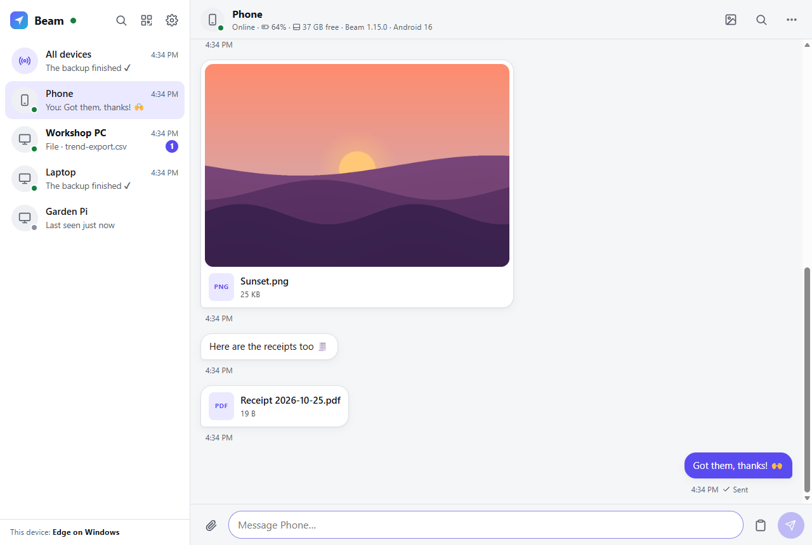
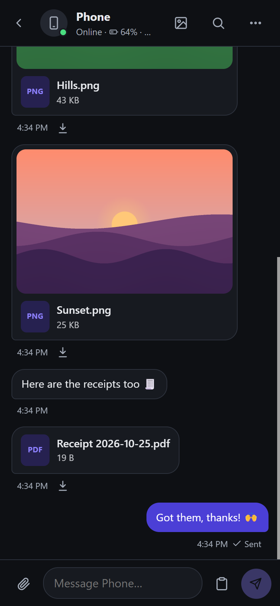
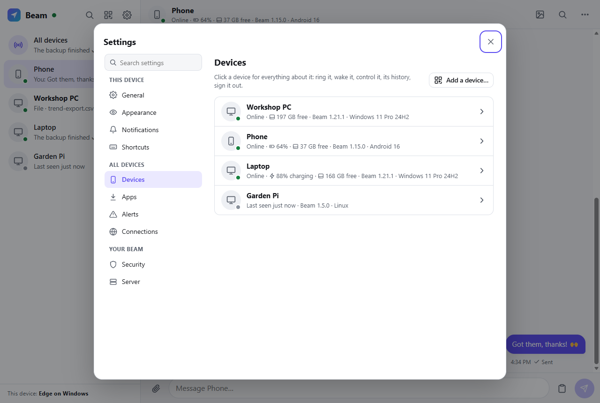
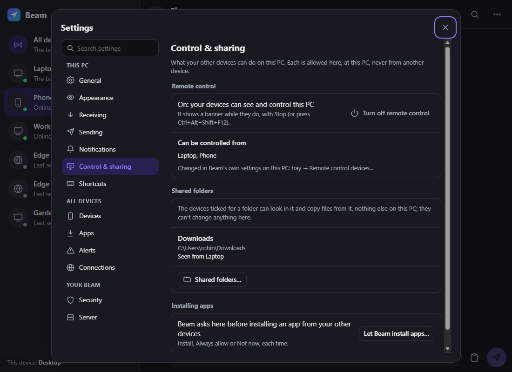

# Light Beam

[](https://github.com/jamesccupps/Light-Beam/actions/workflows/ci.yml)
[](https://github.com/jamesccupps/Light-Beam/releases/latest)
[](LICENSE)

**Website: [jamesccupps.github.io/Light-Beam](https://jamesccupps.github.io/Light-Beam/)** · [Quick start](#quick-start-browser-only) · [Documentation](#documentation)

**Beam** is a private messenger and hub for your own devices, running on your own computer. Send text, links,
photos and files of any size from any device to any other, or to all of them at once. See your phone's
notifications on your PCs and reply to them, ring a lost phone, wake a sleeping PC, or control a PC's screen from
another device. **Beam Family** adds your family's own chat, in the spirit of Discord, on the same machine.

There are no accounts and no third-party cloud. Your devices reach your Beam privately through
[Tailscale](https://tailscale.com), at home or away, without opening any ports.

| Device | How it runs Beam |
|---|---|
| **Anything with a browser** (iPhone, Android, Mac, Linux, Chromebook, Windows) | The web app, which installs to the home screen like an app |
| **Windows** | Optional tray app `Beam.exe`: one self-updating file; its chat window is the same web app (WebView2) |
| **Android** | Optional native app `beam.apk` (share sheet, phone notifications on your PCs, ringing, remote control) |
| **Scripts / terminal** | The `beam` command-line tool, or plain HTTP ([docs/API.md](docs/API.md)) |

The browser is all you need to start: the native apps add system integration, and you build them yourself (see
[Building the apps](docs/BUILDING.md#building-the-apps)).

> **Status:** a personal project, now open source. It is developed and used every day on Windows 11 PCs, an Android
> phone and a Raspberry Pi (Beam for Linux). The server is plain Node.js and its tests run on Linux (Ubuntu) as well as
> Windows; macOS should work but hasn't been tested yet, and neither have the systemd unit and the Docker files.
> Reports and fixes are welcome (see [CONTRIBUTING.md](CONTRIBUTING.md)).



| On a phone | Your devices | The Windows app: control and sharing |
|---|---|---|
|  |  |  |

*(Made-up devices on a test server.)*

## Quick start (browser only)

You need a computer that stays on, with:
- [Node.js](https://nodejs.org) **22.13 or later** (Beam itself runs on 20.12+; Beam Family needs 22.13+ for its
  built-in SQLite);
- [Tailscale](https://tailscale.com/download), installed and signed in (the free plan is plenty).

```bash
git clone https://github.com/jamesccupps/Light-Beam.git
cd Light-Beam
npm install
node server.js
```

In a second terminal, share it over Tailscale (HTTPS, reachable only by your own devices):

```bash
tailscale serve --bg http://127.0.0.1:8765
```

Then, on any device signed in to the same Tailscale account, open `https://<your-computer>.<your-tailnet>.ts.net`
(`tailscale serve status` shows the exact address). The first Tailscale account to sign in becomes Beam's owner,
and your devices sign in by themselves from then on. Install it as an app: Chrome menu → **Install app**, or on an
iPhone Safari's **Share → Add to Home Screen**.

Without Tailscale, `node server.js pair` prints a one-time link and QR code for a device on your home network
(plain HTTP: see [Security](#security)).

To keep it running in the background:
- **Windows:** `windows\build.cmd`, then `powershell -ExecutionPolicy Bypass -File scripts\install-windows.ps1
  -Server`. That runs the server hidden (restarting it if it crashes, and again at every sign-in), shares it over
  Tailscale, and installs the Windows app, already paired. Run it again any time; `-Uninstall` removes everything
  except your items.
- **Linux:** a systemd unit is in [deploy/beam.service](deploy/beam.service) (not tested yet).
- **A NAS or a server:** see [Docker and NAS](docs/SERVER.md#docker-and-nas).

## Adding your other devices

Every device needs the **Tailscale app**, signed in to the same account. Then:

- **Any browser:** open `https://<your-computer>.<your-tailnet>.ts.net`.
- **Android:** once you've built the app, get `beam.apk` from **Add device → Get the app** on a signed-in device
  and install it. Chrome will ask you to allow installing apps from it.
- **Windows:** download `Beam.exe` the same way and run it from anywhere. It finds your Beam over Tailscale by
  itself, and can start with Windows (its Settings).

### Signing in

1. **Automatically.** Your own devices sign in by themselves:
   - Any device signed in to your Tailscale account (Tailscale tells Beam who is visiting, when it goes through the
     Beam address). Beam trusts your account from your first sign-in. Another account (a relative's laptop you
     signed in on with the password, say) isn't trusted just because Beam saw it: it shows under **Settings →
     Security** with an **Allow** button, and trusted accounts can be removed there.
   - A browser on a device that's already running the Beam app.
2. **With your phone.** A new browser or app shows a QR code and a short code. Scan it with a signed-in phone (camera
   or the Beam app) and tap **Approve**. Signed-in devices also pop up an Approve / Deny prompt by themselves. You can
   also type the code under **Add device → Approve a sign-in**, or `beam approve <code>`. Always check that the code
   matches before approving.
3. **Password.** Set one in **Settings → Security → Sign-in password**, then type it on any sign-in screen. On a computer that
   isn't yours, sign in **for this session only**: it ends when the browser closes, or after 12 hours unused.
4. **Pairing link.** Shown under **Add device** (or `node server.js pair`). It works once, within 15 minutes.

Every device gets its own sign-in:
- Removing a device (or **Sign out all other devices** in Settings) signs it out for good, and stops it from signing
  back in automatically through Tailscale.
- A lost device that is still in your Tailscale account can't get back in by itself, but for full safety also remove
  it from Tailscale.

Browsers and apps on the same device are linked automatically. The server recognizes the machine by its Tailscale
address, so the browser becomes part of that device instead of a separate entry.

## Documentation

| | |
|---|---|
| [Using Beam](docs/USING.md) | Sending, the phone and PC features, notifications, remote control, settings |
| [Beam Family](docs/FAMILY.md) | The family's chat: setting it up, the public link, its security model |
| [Command line and iPhone Shortcuts](docs/CLI.md) | The `beam` command, plain HTTP, Shortcuts |
| [Beam for Linux](docs/LINUX.md) | A Raspberry Pi or another Linux computer as a Beam device |
| [Running the server](docs/SERVER.md) | Tailscale and ports, running it as a service, moving, backups, Docker and NAS, Windows Server, configuration |
| [Building the apps](docs/BUILDING.md) | The Windows and Android apps, signing, and the tests |
| [HTTP API](docs/API.md) | Every endpoint, for scripts and other clients |

## Security

The short version (the threat model and how to report a problem are in [SECURITY.md](SECURITY.md)):

- Every device has its own sign-in:
  - **Removing a device** signs it out and blocks its Tailscale machine from signing in automatically.
  - **Sign out all other devices** (Settings) also replaces the master key that older apps and pairing links used.
    Optionally it turns automatic Tailscale sign-in off, for when a phone is stolen.
  - A lost device that is still in your Tailscale account could reach Beam, so **remove it from Tailscale** too.
  - **A removed device wipes what Beam saved on it**: history, unsent messages, drafts and cached photos, the next
    time it reaches your Beam. Files you saved stay.
- Pairing links work once, for 15 minutes. The master key (`data/key`) is only needed by older apps and for
  administration; the `beam` command and newer apps swap it for their own sign-in by themselves.
- Signing in with Tailscale only trusts identities that `tailscale serve` on the Beam machine vouches for (never
  through Funnel), confirmed by `tailscale whois` (no answer means no automatic sign-in), and only at this Beam's own
  address, so a page on another name pointed at your server gets nothing.
- Password guesses are limited: 5 per address and 30 overall per 10 minutes, even in parallel. Keys that don't work
  are limited too.
- Browsers only accept changes from Beam's own pages, so another website on your tailnet can't act in your name.
- Over Tailscale, traffic between your devices and the server is encrypted. Over plain HTTP on your home network it
  isn't: behind `tailscale serve`, set `BEAM_HOST=127.0.0.1` so the server isn't reachable any other way (it warns
  at start otherwise). Items are stored unencrypted in the `data` folder until they expire.
- **The data folder is private:** at every start Beam makes sure only the account it runs as can open it (on Windows
  also SYSTEM and Administrators; elsewhere `chmod 700`).
- **The Beam server's computer is trusted:** `tailscale serve` hands requests to Beam on this machine, so programs
  and other accounts on it could pose as Tailscale traffic. Run the server on a computer only you use.
- **Updates are signed:** the apps install what your server's `dist` folder offers only when it's signed with the key
  they were built with (Windows: `windows\build.cmd`'s key; Android: your keystore, checked by Android itself). Keep
  those keys private and backed up. A first install is taken as your server hands it out (the Windows app, the
  Android app, Beam for Linux): only the updates after it are checked against the key it came with.
- **Who signs in by itself:** only Tailscale accounts you trust: yours from the first sign-in, others only when you
  allow them in Settings → Security, from a sign-in made on purpose (password, pairing link, approval).
- **What a device that signed in by itself can do (1.25):** send and receive. Controlling PCs, installing apps on
  them, the phone's notifications, the password, moves, signing the others out and (1.25.4) the owner's tools (the
  server's log, each PC's log and history, backups, a Windows update to every PC at once) take a *trusted* sign-in:
  one made with the password, or with a pairing link or an approval from a trusted device, or approved once from a
  trusted one (in Beam on your phone, a PC or a browser: Settings → Devices, that device → "Can control PCs and install
  apps"). The first device of a new Beam is trusted. Tailscale's sign-in covers whole machines: any program or account
  on one of yours (an app on your phone, say) could use it. A computer with Beam for Linux is only ever controlled,
  never controls.
- Received files are never opened or run automatically. Uploaded files are served with a locked-down content policy,
  so an uploaded web page can't run scripts inside Beam.
- **Beam Family** is the only part meant to face the internet (through Funnel), and it's a separate server that can't
  reach your devices. Its own model is in [docs/FAMILY.md](docs/FAMILY.md#security-model).

## Roadmap and contributing

Where it's going: [ROADMAP.md](ROADMAP.md). What changed in each release: [CHANGELOG.md](CHANGELOG.md). How to help,
and how the code is laid out: [CONTRIBUTING.md](CONTRIBUTING.md).

## License

[MIT](LICENSE). The Windows app embeds Microsoft's WebView2 SDK, under its own BSD-style license
([windows/lib/webview2/LICENSE.txt](windows/lib/webview2/LICENSE.txt)). The viewer for Linux computers uses noVNC,
unchanged, under the MPL 2.0 (with pako under MIT): [public/novnc/](public/novnc/README.md).
